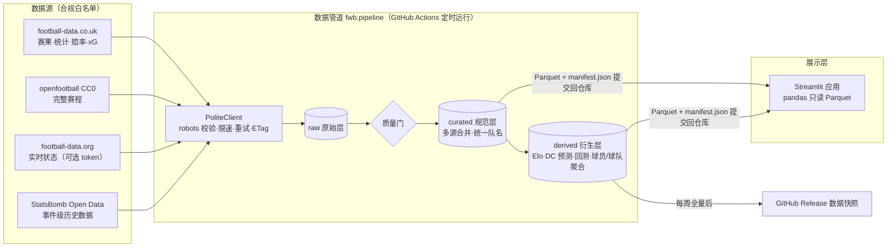

# ⚽ 足球分析工作台（Football Workbench）

五大联赛 · 零成本 · 自动更新 · 数据源全部合规（robots.txt 与服务条款均于 2026-09-26 逐一核实）

- **联赛看板**：积分榜 + xG 积分榜（xPts）、运气偏差、Elo 走势、赛果与赛程
- **球队战术**：当季 xG/xGA 滚动走势、攻防定位；StatsBomb 事件实验室（传球网络、射门图、PPDA、xT、场地倾斜）
- **球员评估**：每 90 分钟指标、同位置百分位披萨图、相似球员检索、散点探索
- **比赛预测**：Dixon-Coles / Elo / 市场三方概率对比，逐周滚动回测（RPS、对数损失、Brier、校准曲线）
- **数据状态**：数据版本、运行日志、分区清单（实时 / 历史 / 衍生）、合规说明

---

## 一、架构说明



**分层解耦**：数据源适配器（`fwb/sources`）只负责"拿到并规范化"；存储层（`fwb/storage.py`）只认 Parquet 分区与 manifest；分析层（`fwb/analytics`）只读数据、不发网络请求；应用读取仓库内的 Parquet，唯一的在线请求是球队页"单场分析"按需读取该场 StatsBomb 事件（同样经过合规客户端、缓存 7 天、失败时降级提示）。替换数据源或升级模型互不影响。

### 三类数据的处理策略

| 类别 | 内容 | 来源 | 更新方式 | 频率 |
|---|---|---|---|---|
| **实时** | 未来赛程、比赛状态、赛前赔率、射手榜 | openfootball、fixtures.csv、football-data.org | 每次运行**整体覆盖**为最新快照 | 每日 05:17 UTC + 周末 22:47 UTC |
| **历史** | 已完赛赛果/技术统计/收盘赔率/xG；StatsBomb 事件 | football-data.co.uk、StatsBomb | 当季以整季文件**替换分区**（自动吸收事后修正，行数骤降 >5% 拒绝写入）；往季冻结，仅全量模式重拉；ETag/Last-Modified 条件请求，未变化即 304 跳过 | 增量每日；**全量兜底每周一** |
| **衍生** | Elo、Dixon-Coles 预测、滚动回测、球员/球队聚合、xT | 由原始/规范层计算 | 每次运行**重算**，带 `model_version`，永不回写原始层 | 随每次运行 |

### 更新机制：增量 + 全量兜底

| 模式 | 触发 | 做什么 |
|---|---|---|
| `incremental` | 每日 + 周末加跑 | 只处理当季；条件请求（未变化直接跳过）；重建当季规范表；重算预测与当季回测 |
| `full` | 每周一 / 手动 | 重新下载全部配置赛季（默认当季 + 前 3 季）、重建规范表、重跑全部回测；成功后发布 `data-YYYY-Www` 快照 Release |
| `statsbomb` | 手动（一次性） | 回填 StatsBomb 事件聚合，只处理新增或 `last_updated` 变化的比赛；每 50 场存检查点 |

可靠性设计：
- 管道幂等，漏跑下次自动补上；写入确定性（排序求和、内容哈希），数据未变化时零提交。
- 单个数据源抓取失败（网络、429/5xx、robots 暂不可用）只记警告，其他源照常更新，运行状态记为 `partial`；质量门失败则退出码非 0、不提交、自动开 issue。
- 本地分区缺失时忽略 ETag 强制完整拉取，避免 304 掩盖数据缺失。
- 队名在每次合并时用最新别名表重新解析，即使远端返回 304 也会生效；新赛季初 co.uk 尚无数据时用上季队名兜底，赛程不丢。
- 定时任务末尾调用官方 API 保活，防止 60 天无活动被禁用；cron 避开整点高峰；增量与全量共用并发组，不会同时写入；`--leagues` 只影响指定联赛的分区。

### 目录结构

```
config/settings.yaml        联赛、赛季(auto 自动滚动)、数据源开关与限速、模型参数
config/team_aliases.csv     跨源队名别名表（可手工补充）
fwb/http.py                 合规 HTTP 客户端（robots.txt / 限速 / 重试 / 条件请求）
fwb/storage.py              Parquet 分区存储 + manifest（版本、水位线、运行日志）
fwb/teams.py                队名归一化（精确→别名→词集→模糊，失败不猜测）
fwb/sources/                football_data_uk · openfootball · football_data_org · statsbomb_open
fwb/pipeline/               run（编排）· curate（多源合并）· quality（质量门）
fwb/analytics/              league · team · models（DC/Elo/回测）· events（StatsBomb 指标）· players
fwb/app/                    应用端数据缓存与公共 UI
streamlit_app.py            应用入口；app_pages/ 五个页面
data/                       raw / curated / derived 三层 Parquet + manifest.json（由 Actions 自动提交）
.github/workflows/          update-data.yml（数据更新）· ci.yml（3.13/3.14 双版本测试）
tests/                      83 项离线单元测试（含确定性、时区、队名、合规语义回归）+ 5 个页面的 AppTest 冒烟测试
```

---

## 二、资源清单

### 采用的开源项目（许可证与活跃度均来自 GitHub API / PyPI，查询日期 2026-09-26）

| 项目 | GitHub 地址 | 功能简介 | 许可证 | 活跃度 | 推荐理由 |
|---|---|---|---|---|---|
| penaltyblog | https://github.com/martineastwood/penaltyblog | Dixon-Coles 等进球模型、Elo/Pi 评分、去抽水隐含概率、RPS、预训练 xT | MIT | 227★ · 最近推送 2026-09-13 · v1.12.2 | 模型均有论文依据与测试，避免自行推导；Python 3.14 有 wheel |
| mplsoccer | https://github.com/andrewRowlinson/mplsoccer | 球场绘图、传球网络、射门图、披萨图/雷达图 | MIT | 545★ · 2026-09-14 · v1.8.1 | 足球可视化事实标准，原生支持 StatsBomb 坐标 |
| streamlit | https://github.com/streamlit/streamlit | Web 应用框架 | Apache-2.0 | 45.8k★ · 2026-09-26 · v1.64.0 | 纯 Python，免费托管到 Community Cloud |
| pandas / pyarrow | https://github.com/pandas-dev/pandas | 数据处理 / Parquet 读写 | BSD-3-Clause / Apache-2.0 | v3.0.6 / v25.0.1 | 数据量仅数 MB，pandas 直读 Parquet 足够；不引入额外数据库 |
| plotly.py | https://github.com/plotly/plotly.py | 交互式图表 | MIT | 18.8k★ · 2026-09-25 · v7.1.0 | 悬停提示、缩放，与 Streamlit 集成好 |
| actions/checkout · actions/setup-python | https://github.com/actions/checkout | CI 基础 Action | MIT | v7.0.1 / v7.0.0（2026-07-20） | 官方维护 |

### 采用的数据（均为免费、合规）

| 数据 | 地址 | 内容 | 许可 / 条款 | robots.txt（实测） | 数据类别 |
|---|---|---|---|---|---|
| football-data.co.uk | https://www.football-data.co.uk | 五大联赛赛果、射门/角球/红黄牌、赛前与**收盘**赔率；**2026/27 起含 HxG/AxG** | 免费下载；免责声明未限制分析用途 | 通用 UA 无限制（仅屏蔽 GPTBot/ClaudeBot 等 AI 爬虫） | 历史 + 准实时 |
| openfootball/football.json | https://github.com/openfootball/football.json | 五大联赛整季赛程与比分 | **CC0-1.0** | raw.githubusercontent.com 返回 404 = 不限制 | 实时（赛程） |
| football-data.org v4（可选） | https://www.football-data.org | 比赛状态、比分、射手榜 | 官方 API，需免费 token，遵守限流 | API 无 robots；站点仅屏蔽 dotbot | 实时 |
| StatsBomb Open Data | https://github.com/statsbomb/open-data（现 hudl/open-data） | 事件级数据：**2015/16 英超/西甲/意甲/法甲整季**（380/380/380/377 场）及其他赛事 | 使用须**注明 StatsBomb 并使用其 logo**（应用页脚已署名） | 同上 | 历史（事件级） |

### 评估后未采用

| 项目 / 数据源 | 许可证 | 活跃度 | 不采用原因 |
|---|---|---|---|
| Understat（及 understat / understatAPI 等封装） | MIT（封装库） | understat 最近推送 2025-12；understatAPI 2026-02，锁定了 2020 年代初的旧依赖 | **robots.txt 为 `User-agent: * / Disallow: /`**，禁止任何自动抓取 |
| FBref（worldfootballR、soccerdata 的 FBref 模块） | — | worldfootballR **已归档**（2025-09） | robots.txt 对脚本请求返回 403；Sports Reference 对爬虫有严格封禁政策 |
| probberechts/soccerdata | PyPI 为 Apache-2.0（GitHub 显示 NOASSERTION） | 2.1k★ · 2026-09-17 · v1.9.1 | 维护良好，但主要抓取的源（FBref、WhoScored、Sofascore、Understat 等）大多不合规；依赖 seleniumbase 较重 |
| statsbombpy | **仓库无 LICENSE 文件**（许可不明） | 2026-09-07 | 许可不明，改为直接读取 open-data 原始 JSON，功能等价 |
| ScraperFC | GPL-3.0 | 2026-05 | 传染性许可证；抓取的源多数不合规 |
| LanusStats | GitHub 未声明（PyPI 标 MIT） | 2026-05 | 依赖 undetected-chromedriver 绕过反爬，与合规目标冲突 |
| socceraction（VAEP/xT） | MIT | PyPI 最新 1.5.3 发布于 2024-08 | 要求 Python <3.13、numpy<2、pandas<3，与 2026 年主流环境冲突；改用 penaltyblog 的 xT |
| floodlight | MIT | 2026-05 | 要求 Python <3.14、pandas<3 |
| ClubElo API | — | — | 2026-09 实测：按日期查询返回 502，Fixtures 接口显示 "deactivated"；改为自算 Elo |
| FotMob / Sofascore / WhoScored / Transfermarkt | — | — | 服务条款禁止自动抓取（FotMob 的 robots.txt 还禁止 `/api/*`） |

> **关于球员数据的限制**：五大联赛**当季**球员级高阶数据目前没有合规的免费来源，因此球员评估页基于 StatsBomb 的完整历史赛季来做。这套分析方法完整可复用：接入授权数据源（如付费 API）后，只要产出同结构的 `sb_player_match` 表，页面即可直接使用。

---

## 三、核心代码

| 关注点 | 位置 | 要点 |
|---|---|---|
| 合规抓取 | [fwb/http.py](fwb/http.py) | 首次访问主机先读 robots.txt（RFC 9309：4xx 视为允许，5xx 保守视为禁止）；每个主机独立限速；429/5xx 指数退避并遵守 Retry-After；ETag 条件请求 |
| 存储与版本 | [fwb/storage.py](fwb/storage.py) | Hive 分区 Parquet，写入是确定性的，内容哈希不变就不重写，git 不会出现无意义 diff；`guard_drop` 防止残缺文件覆盖正常数据；manifest 的 `data_version` 用作应用缓存键 |
| 队名统一 | [fwb/teams.py](fwb/teams.py) · [config/team_aliases.csv](config/team_aliases.csv) | 只在当季同联赛的规范队名集合内匹配；解析失败的行不进入规范表并告警 |
| 多源合并 | [fwb/pipeline/curate.py](fwb/pipeline/curate.py) | 完赛数据以 co.uk 为准；它尚未收录的比赛由 fdorg 补、再由 openfootball 补；统计各来源的比分冲突 |
| 质量门 | [fwb/pipeline/quality.py](fwb/pipeline/quality.py) | 主键唯一、球队数 ≤20、比分合法、双循环场次上限、概率和为 1 |
| 预测与回测 | [fwb/analytics/models.py](fwb/analytics/models.py) | Dixon-Coles（带时间衰减）；Elo 赛季间回归 20%，升班马继承降级队的平均分；按"周二–周四 / 周五–周一"窗口滚动重训；与收盘赔率在同一样本上比较 |
| 事件指标 | [fwb/analytics/events.py](fwb/analytics/events.py) | xG/npxG（StatsBomb 自有模型）、xA、推进传球（Wyscout 定义）、PPDA、xT（penaltyblog 预训练曲面，含坐标换算）、传球网络；**出场时间由事件流推导**，因为阵容表不记录红牌、且存在半场编号错乱；**球队一律按 team_id 关联**，因为同一球队在事件与索引中名字可能不同（实测 'Caen' 与 'Stade Malherbe Caen'） |
| 球员球探 | [fwb/analytics/players.py](fwb/analytics/players.py) | 每 90 分钟指标、同位置百分位（设最低分钟门槛）、z-score 余弦相似度 |

**真实数据的实测结果**（2026-09-26 全量运行；2024/25、2025/26 两个整季 + 2026/27 当季已赛部分的滚动样本外回测，RPS 越低越好）：

| 联赛 | 样本 | Dixon-Coles | Elo | 市场收盘赔率 |
|---|---|---|---|---|
| 英超 | 803 | 0.2053 | 0.2082 | **0.2007** |
| 西甲 | 821 | 0.2014 | 0.2017 | **0.1916** |
| 德甲 | 641 | 0.2076 | 0.2075 | **0.1953** |
| 意甲 | 804 | 0.1982 | 0.2024 | **0.1901** |
| 法甲 | 651 | 0.2109 | 0.2098 | **0.2014** |

市场在每个联赛都最准，两个统计模型差距约 0.005–0.012。这是符合预期的健康结果：如果模型"跑赢"收盘赔率，更可能说明存在信息泄漏。以后做任何改进（例如引入 xG 特征），都应以缩小与市场的差距来检验。

StatsBomb 聚合的合理性抽查：2015/16 场均非点球 xG 前列为本泽马、C 罗、伊瓜因、苏亚雷斯、伊布、卡瓦尼；PPDA 最低（逼抢最凶）为塞尔塔、巴萨、巴黎。

**扩展一个新数据源**：在 `fwb/sources/` 新建模块，经 `fwb.http.client()` 发请求 → 在 `storage.TABLES` 注册表 → 在 `pipeline/run.py` 的 `ingest()` 中调用 → 需要参与合并时修改 `curate.merge()`。

---

## 四、部署指南

### 1. 本地运行（Windows / macOS / Linux，Python 3.13 或 3.14）

```bash
python -m venv .venv
```
```bash
.venv\Scripts\activate
```
（macOS/Linux 用 `source .venv/bin/activate`）
```bash
pip install -r requirements-dev.txt
```
```bash
python -m fwb.pipeline --mode full
```
```bash
python -m fwb.pipeline --mode statsbomb
```
```bash
streamlit run streamlit_app.py
```

- `--mode full` 首次约 2 分钟（每个主机请求间隔 3 秒）；`--mode statsbomb` 为一次性回填，约 1,500 场、30–45 分钟，可用 `--max-matches 100` 分批跑。
- 可选：设置环境变量 `FOOTBALL_DATA_ORG_TOKEN`（免费注册 https://www.football-data.org/client/register ）以启用实时比分和射手榜。
- 运行测试：`pytest -q`

### 1.5 本机一键分享给朋友（实时更新）

双击项目根目录的 **`start_share.bat`** 即可。它会做这些事：

1. 首次运行时自动创建 `.venv` 并安装依赖，约 3–5 分钟。
2. 提示粘贴 football-data.org 的免费 token（注册地址 https://www.football-data.org/client/register ）。输入内容不会显示在屏幕上，会先向官方接口验证有效性，再保存到本机的 `.streamlit/secrets.toml`（已被 git 忽略）。直接回车可以跳过，只是没有实时比分。
3. 启动应用；后台**每 30 分钟**增量更新一次数据，每 7 天自动全量兜底一次。日志在 `logs/` 目录。
4. 通过 `tools/cloudflared.exe`（Cloudflare 官方签名程序）建立临时公网隧道，窗口里会显示 `https://xxx.trycloudflare.com`，这就是发给朋友的链接。链接同时写入 `share_url.txt`，并尝试复制到剪贴板。
5. 「实时比分」页每 60 秒自动刷新。所有访客共享同一份缓存，所以不管多少人在看，API 都是每分钟最多请求 1 次，不会超出免费配额。

需要注意：
- **窗口关掉，链接就失效**；每次启动都会生成新链接。
- 运行期间会阻止电脑睡眠，但屏幕可以正常息屏；关闭窗口后恢复原来的电源设置。
- Cloudflare 把 Quick Tunnel 定位为测试用途，不保证可用性，适合临时发给朋友。
- 朋友看到的是只读页面，开发者菜单已隐藏，页面上的报错信息也不会显示本机路径。

常用参数：`start_share.bat --interval 15`（改为每 15 分钟更新）、`--no-tunnel`（只在本机或同一 Wi-Fi 下访问，地址为 `http://你的局域网IP:8501`）、`--port 8502`。

### 2. 云端部署（零成本）

1. **建仓库**：把本目录推到一个**公开**的 GitHub 仓库（公开仓库使用标准 runner 的 Actions 完全免费）。把 `config/settings.yaml` 里 `http.user_agent` 中的 URL 改成你的仓库地址。
2. **Actions 权限**：Settings → Actions → General → Workflow permissions 选 **Read and write**。
3. **可选 Secret**：Settings → Secrets and variables → Actions → New repository secret，名称 `FOOTBALL_DATA_ORG_TOKEN`。
4. **首次引导**：Actions → update-data → Run workflow，先选 `full`，再选 `statsbomb`（仓库中已带有一份数据时可以跳过）。
5. **部署应用**：https://share.streamlit.io → Create app → 选择仓库，Main file path 填 `streamlit_app.py`，**Advanced settings 中把 Python 设为 3.13**（部署后无法更改）。`packages.txt` 会自动安装中文字体。
6. 之后 Actions 每次提交数据，Streamlit Cloud 会自动拉取；应用以 `data_version` 作为缓存键，新数据立即生效。

### 3. 验证清单

- [ ] `pytest -q` 全部通过（本地实测 88 项：83 项单元测试 + 5 项页面冒烟测试）
- [ ] Actions → update-data 手动运行 `incremental` 成功，Step Summary 中能看到"304 未变化跳过"计数
- [ ] 仓库 `data/manifest.json` 的 `last_run.status` 为 `success`（`partial` 表示有数据源临时抓取失败，其余已更新），`data_version` 只在数据真正变化时改变
- [ ] 连续两次手动运行 `incremental`，第二次 Step Summary 显示变更分区 0（写入确定性）
- [ ] 应用侧边栏显示 ✅ 和最近的更新时间（超过 36 小时会显示 ⚠️）
- [ ] 联赛看板的积分榜与官方一致（相互战绩等排名细则除外）
- [ ] 比赛预测 → 回测评估：各联赛 Dixon-Coles 的 RPS 与市场差距在 0.01 以内（差距过大说明数据或模型有问题）
- [ ] 数据状态页没有队名映射告警；如有，在 `config/team_aliases.csv` 补充别名
- [ ] 周一全量运行后，Releases 中出现 `data-YYYY-Www` 快照

### 4. 运维要点

- **赛季滚动**：`seasons.current: auto`，7 月 1 日起自动切换到新赛季，无需改配置。新赛季开赛前 co.uk 还没有当季文件，此时 Step Summary 会给出 404 警告，属正常现象。
- **升班马队名**：新赛季首轮后如出现"队名未能映射"警告，在 `config/team_aliases.csv` 中加一行即可。
- **回滚数据**：从 Releases 下载对应周的快照，解压覆盖 `data/` 后提交。
- **仓库体积**：当前全部数据约 5 MB；往季分区冻结，每天只有当季的小分区变化。
- **失败告警**：管道失败时自动创建或追加 issue「数据管道运行失败」，附运行日志链接。
- **休眠**：Streamlit Community Cloud 的应用 12 小时无访问会休眠，访问时点一下即可唤醒。不要用定时任务去"保活"应用，这违背 GitHub Actions 的使用条款精神。

---

本项目仅用于足球数据分析、研究与教学；模型概率不构成任何投注建议。数据版权归各数据提供方所有，使用时请遵守其条款并保留署名（尤其是 StatsBomb）。
